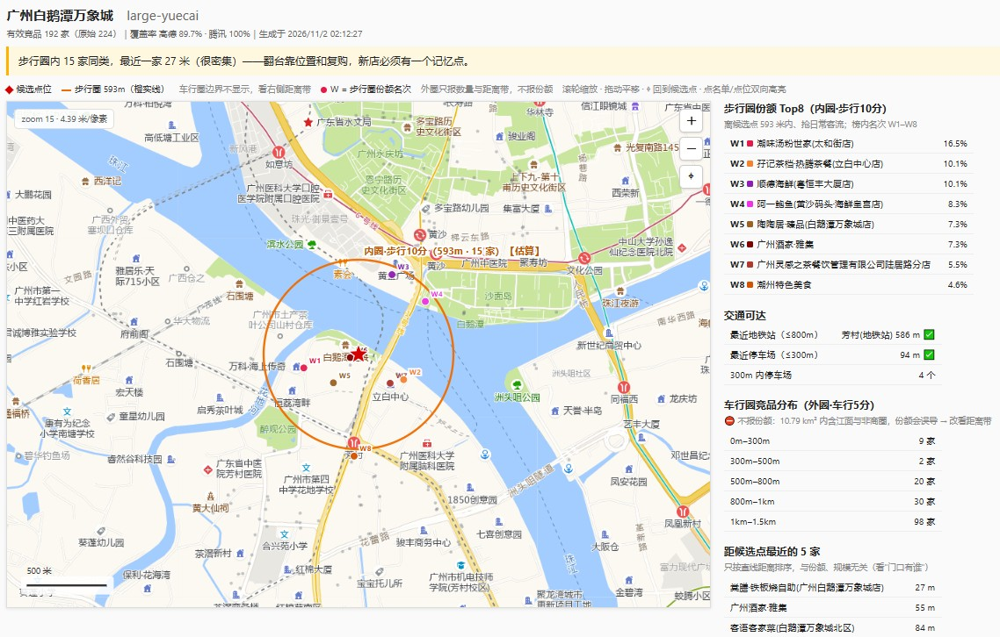
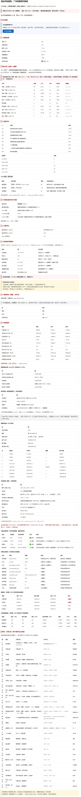

# 选址智能分析 Skill

<p>
  <a href="https://github.com/ShaoRoy/site-selection-skill/releases/latest"></a>
  <a href="https://github.com/ShaoRoy/site-selection-skill/releases"></a>
  <a href="https://github.com/ShaoRoy/site-selection-skill/actions/workflows/ci.yml"></a>
  
  <a href="LICENSE"></a>
</p>

> 给 AI Agent 用的连锁餐饮 / 实体门店选址评估能力包 · v2.10.16

Tool 硬算 + Skill 只翻译。所有确定性计算交给脚本，Skill 只负责定口径、组织流程、把结果翻译成人能读的报告。

---

## ⬇️ 下载

| 你要做什么 | 下这个 | 多大 |
|---|---|---|
| **WorkBuddy「导入技能」** | [`site-selection-skill-v2.10.16.zip`](https://github.com/ShaoRoy/site-selection-skill/releases/latest) | 1.2 MB |
| **WorkBuddy「配置专家」** | [`site-selection-expert-v2.10.16.zip`](https://github.com/ShaoRoy/site-selection-skill/releases/latest) | 1.1 MB |
| **DeepSeek Harness** | 不用下载，见下方[安装](#安装)：`git clone` + `install.ps1` | — |

> ⚠️ **别用 GitHub 网页的「Code → Download ZIP」**——它会套一层 `site-selection-skill-main/`，
> 传到 WorkBuddy「导入技能」会报「所选文件夹中未找到 SKILL.md」。用上面的 Release 附件。

> 本文件是**精简入口**。完整计算口径（十节口径规范 + 22 条公式）见 [`docs/SKILL-FULL.md`](docs/SKILL-FULL.md)。

---

## 报告示例





---

## 它能干什么

| 能力 | 说明 |
|---|---|
| **城市网格扫描** | 按网格批量扫一片区域，自动筛候选点位 |
| **需求侧采集** | POI 代理指标：周边小区、写字楼、学校、交通 |
| **竞品格局分析** | 步行圈内竞品数量、距离、品类分布、份额 Top8 |
| **截流两轴** | 内圈步行圈 + 外圈车行圈，双口径客流截流评估 |
| **财务双口径测算** | 保本营业额、毛利、回本周期、投产 ROI |
| **行业基准对标** | 同业态、同城市、同面积的行业均值对标 |
| **动线阻断分析** | 点位到地铁口 / 竞品 / 小区大门的步行距离 |
| **证据链报告** | 每个数字可追溯：公式 + 代入值 + 结果 |

## GIS 空间分析能力

| 能力 | 说明 |
|---|---|
| **多坐标系转换** | WGS84 / GCJ02（高德）/ BD09（百度）互转，解决不同数据源坐标系不一致问题 |
| **步行圈 / 车行圈** | 内圈步行 10 分钟 + 外圈车行 5 分钟，双口径截流评估 |
| **等时圈估算** | 基于路网的步行可达范围分析，未接本地路网时降级为直线估算（标注【估算】） |
| **POI 空间聚合** | 按距离 / 时间范围聚合周边 POI，自动统计品类分布、密度、最近距离 |
| **空间去重** | 同品类 POI 自动去重，白名单品类保留，避免竞品重复计数 |
| **动线阻断分析** | 点位到地铁口 / 竞品 / 小区大门的步行距离与路径阻断识别 |
| **城市网格扫描** | 按经纬度网格批量扫描区域，自动标记已覆盖 / 未覆盖网格 |
| **地理编码** | 地址 → 经纬度坐标，支持批量点位解析 |

## 数据源与对接能力

本项目的数据维度参照商用选址平台设计，用公开数据源实现同一套分析框架。

### 数据维度对标（个人版实现方式）

商用选址平台（慧眼、数据魔方等）的核心维度是：客群画像、到访洞察、商圈成熟度。本项目用公开数据源实现**同一套分析框架**。

| 维度 | 商用平台 | 本项目 |
|---|---|---|
| 商圈成熟度 | 实时客流 | POI 业态密度 + 品牌密度（咖啡 / 银行 / 高端餐饮）代理 |
| 竞对分布 | 商圈竞品库 | 高德 POI + 三重去重 + 三级分层 |
| 人流动线 | 停留时长 | 等时圈 + 现场动线阻断实测 |
| 客群画像 | 人口属性画像 | 职住比 + 住宅/写字楼结构（代理） |

### 当前已接入的数据源

| 数据源 | 用途 | 状态 |
|---|---|---|
| **高德开放平台 POI** | 周边业态、竞品、交通配套采集 | ✅ 已接入（个人 Key，须选「Web 服务」类型） |
| **高德步行路径规划** | 动线阻断（点位 → 地铁口 / 竞品 / 小区大门） | ✅ 已接入 |
| **行业基准库（19 城 × 48 业态）** | 财务结论的现实性对标 | ✅ 已内置 `data/benchmarks.json` |
| **OSM 开源路网** | 本地 Valhalla / OSRM 等时圈 | ⚠️ 需自行部署引擎；未部署时降级为直线估算并标注【估算】 |
| **七普人口、城市规划公开矢量** | 人口结构、片区规划参考 | ⚠️ 人工查阅，未做程序化接入 |

### 规划中（尚未实现）

| 数据源 | 计划用途 | 当前状态 |
|---|---|---|
| **开源人口栅格**（WorldPop 2020, 93m） | 交叉校验：栅格常住人口 vs POI 代理密度 | ✅ 已接入（`worldpop-clip.py` + `worldpop-sample.py`，需 QGIS 提供 GDAL） |
| **商用客流接口**（慧眼 / 位置服务等） | 客群画像、到访洞察 | ⛔ 个人开发者无法采购；仅预留结果字段，未做接入 |

> **关于「替换数据源」**：目前各采集脚本（`demand-fetch.py` / `grid-scan.py` / `walk-matrix.py`）的高德调用是**直接写在各脚本内部**的，没有统一适配层。将来接入商业数据源时，需要先抽出 `datasource/` 适配层再替换实现——**不是改一行配置就能完成**。

## 设计原则

- **不判断"能不能开"**，只列证据与缺口
- **每个数字可追溯**：公式 + 代入值 + 结果
- **缺省必须披露**：用了默认值就写进台账
- **不用可刷的数据验证模型**（点评评分 / 月售一律不采）
- 人口数据无公开免费接口，当前用 POI 代理指标；人口栅格交叉校验尚未接入

## 依赖与环境

### 必需

| 依赖 | 版本 | 用途 | 缺失后果 |
|---|---|---|---|
| **Python** | ≥ 3.9 | 全部计算脚本 | 脚本类功能不可用（SKILL.md 方法论仍可读） |
| **高德开放平台 Key** | 免费注册 | POI 检索 / 地理编码 / 步行路径 | 采集类脚本报缺凭证 |

### 可选（按需安装）

| 依赖 | 用途 | 缺失后果 |
|---|---|---|
| **openpyxl** | import-benchmarks.py 读取 Excel 底稿 | 仅更换行业基准数据时需要，日常运行不受影响 |
| **Node.js ≥ 18 + pnpm** | DSH 原生插件、运行测试套件 | 只能用 Python 脚本模式，无原生工具 |
| **Docker + Valhalla / OSRM** | 真实路网等时圈（本地部署） | 降级为直线估算，报告标注【估算】 |
| **QGIS ≥ 3.28** | 读取人口栅格 GeoTIFF、出正式地图 | 纯计算不受影响，仅影响栅格处理与制图 |
| **磁盘 3 GB** | Valhalla 广东瓦片约 2 GB（可选） | 只用 Python 模式约需 5 MB |

### 每个脚本的真实依赖

| 脚本 | 第三方包 |
|---|---|
| site_core.py（6 个核心工具） | **无**，纯标准库 |
| grid-scan.py / grid-registry.py | **无** |
| demand-fetch.py / walk-matrix.py | **无** |
| import-benchmarks.py | openpyxl |

> 也就是说：**装个 Python 3.9 就能跑核心计算**，其余都是可选的。

### 支持的平台

| 平台 | 说明 |
|---|---|
| Windows 10 / 11 | 推荐，install.ps1 一键安装（PowerShell 5.1 或 7 均可） |
| macOS / Linux | Python 脚本同样可用，手动复制目录到 ~/.dsh/skills/restaurant-location-analysis |

## 安装

### 前置依赖

- **Python 3.9+**（脚本类功能需要；纯方法论模式可不用）
- **高德开放平台 Web 服务 Key**（POI / 地理编码 / 步行路径必需；无 Key 时脚本会报缺凭证，但 Skill 方法论本身可读）

### 方式 A：一键脚本（推荐，Windows）

```powershell
# 1. clone 或下载本仓库
git clone https://github.com/ShaoRoy/site-selection-skill.git
cd site-selection-skill

# 2. 运行安装脚本（默认装到 ~/.dsh/skills/restaurant-location-analysis）
powershell -File install.ps1

# 装到自定义目录：
# powershell -File install.ps1 -Target "D:\your\skills\restaurant-location-analysis"
```

脚本会自动做三件事：复制文件 → 检查 Python/openpyxl → 检查高德 Key。

### 方式 B：手动安装

```powershell
# 1. clone 仓库
git clone https://github.com/ShaoRoy/site-selection-skill.git "$env:USERPROFILE\.dsh\skills\restaurant-location-analysis"
cd "$env:USERPROFILE\.dsh\skills\restaurant-location-analysis"

# 2. 安装 Python 依赖（仅 import-benchmarks.py 需要 openpyxl）
pip install openpyxl
```

### 配置高德 Key

二选一：

```powershell
# 方式 1：环境变量（当前会话）
$env:AMAP_API_KEY = "你的高德 Web 服务 Key"

# 方式 1 持久化（用户级，重启终端生效）
[Environment]::SetEnvironmentVariable("AMAP_API_KEY", "你的高德 Web 服务 Key", "User")

# 方式 2：写入密钥文件（推荐，避免环境变量泄露到子进程）
New-Item -ItemType Directory -Force -Path "$env:USERPROFILE\.dsh\secrets" | Out-Null
"你的高德 Web 服务 Key" | Out-File -FilePath "$env:USERPROFILE\.dsh\secrets\amap.key" -Encoding ascii -NoNewline
```

> 注意：高德控制台要选 **「Web 服务」** 类型的 Key，不要用 Android / iOS / Web端(JS API) 类型，否则接口会报 `INVALID_USER_KEY`。

### 自检（必做）

```powershell
cd "$env:USERPROFILE\.dsh\skills\restaurant-location-analysis"
python scripts/site_core.py selftest
```

看到 `20 passed` / 全绿，说明计算内核 OK。如果报错，先看是不是 Python 版本低于 3.9。

### DSH 原生插件挂载（可选）

如果你用 DSH，除了 Python 脚本模式，还可以挂原生 TypeScript 工具：

1. 打开 `dsh/cordis.patch.yml`，按里面注释把插件条目加到 DSH 的配置里
2. 重启 DSH，让插件索引生效
3. 重启后在对话里说"用 site-selection 评估一下 XXX 铺位"验证是否触发

### WorkBuddy 上传：两个入口，两种结构

WorkBuddy 有两个上传入口，**包结构要求不同，传错必定报错**：

| 入口 | 要求 | 怎么打包 |
|---|---|---|
| **导入技能** | zip 根目录直接有 `SKILL.md` | 把仓库**内容**打包，不带最外层文件夹 |
| **配置专家** | zip 内有一层文件夹，且含 `<名>/.codebuddy-plugin/plugin.json` | 仓库根改名为 `site-selection-analyst/` 再打包 |

> ⚠️ **不要用 GitHub 网页的「Download ZIP」直接上传**——它会套一层
> `site-selection-skill-main/`，「导入技能」会报「所选文件夹中未找到 SKILL.md」。

```bash
git clone https://github.com/ShaoRoy/site-selection-skill.git

# 导入技能：只打包内容
cd site-selection-skill && zip -r ../01-skill.zip * -x ".git/*"

# 配置专家：先改成一层文件夹
cd .. && mv site-selection-skill site-selection-analyst
zip -r ../02-expert.zip site-selection-analyst -x "*.git*"
```

本仓库根目录已含专家所需结构，可直接按上表打包：

```
.codebuddy-plugin/plugin.json   ← 专家配置（16 个必填字段）
agents/site-selection.md        ← Agent 人设 + frontmatter
avatars/expert.png              ← 头像 512×512
```

### 上传报错对照

| 报错 | 原因 | 解法 |
|---|---|---|
| 所选文件夹中未找到 SKILL.md | 传了专家包到「导入技能」 | 用**不带外层文件夹**的包 |
| 未找到 .codebuddy-plugin/plugin.json | 传了技能包到「配置专家」 | 用**带一层文件夹**的包 |
| 专家名称已被占用 | `plugin.json` 的 `name` 撞名 | 改 `name` 与 `plugin`（两处一起改） |
| 没有 skill | SKILL.md 缺 `title` / `summary` | 当前版本已具备 |

### 验证安装成功

自检通过后，在你的 Agent 里发一句：

```
用 site-selection 帮我评估一下：广州天河珠江新城某商场 1 楼 80㎡ 奶茶铺，月租 1.8 万，投资 25 万，客单价 18 元。
```

Agent 应该会：读 `SKILL.md` → 调 `scripts/site_core.py` 算财务口径 → 输出带公式追溯的报告。如果它直接"凭感觉"给结论，说明 Skill 没被加载，回上面检查目录位置。

### 常见坑

| 现象 | 原因 / 解决 |
|---|---|
| `INVALID_USER_KEY` | 高德 Key 类型选错，去控制台换「Web 服务」类型 |
| `python: command not found` | 没装 Python 或没加 PATH；脚本类功能不可用，但 SKILL.md 方法论仍可读 |
| Agent 不触发 Skill | 检查是否真的解压到了 `~/.dsh/skills/restaurant-location-analysis/`（目录名要叫 `site-selection`，不是 `site-selection-skill`） |
| `openpyxl` 导入失败 | `pip install openpyxl`；只有 `import-benchmarks.py` 需要 |
| 路径含中文 / 空格 | 部分脚本对路径敏感，建议装在纯英文路径 |
| 高德额度耗尽 | 个人开发者默认日额度 5000 次，网格扫描前先 `--dry-run` 看预计调用量 |

## 快速开始

```bash
# 扫一片区域，找候选点位
python scripts/grid-scan.py --city 广州 --district 天河 --execute

# 给某点位算需求侧指标
python scripts/demand-fetch.py "广州白鹅潭万象城" --radius 3000 --out demand.json

# 算动线阻断（点位到地铁口 / 竞品 / 小区大门的步行距离）
python scripts/walk-matrix.py --origin "23.1035,113.2361" --targets targets.csv --out barriers.csv

# 看网格覆盖进度
python scripts/grid-registry.py --city 广州 --summary

# 财务测算
python scripts/site_core.py finance --format large_yuecai --area 1200 --catchment L2 \
  --params params.json --space space.json --out finance.json

# 行业基准对标
python scripts/site_core.py benchmark --city 广州 --format 粤式茶楼早茶 --area 1200 \
  --investment-wan 320 --rent-wan 12 --ticket 230 --revenue-wan 99 --payback 15.5 --margin 0.208

# 看当前生效的业态规则（自定义规则改了先跑这个）
python scripts/site_core.py formats

# 人口栅格：按城市裁切（一次性，之后复用；需 QGIS 的 GDAL）
"QGIS/bin/python-qgis-ltr.bat" scripts/worldpop-clip.py \
  --src "D:/下载/chn_ppp_2020.tif" --city 广州 --outdir data/worldpop

# 点位人口采样 + 与 POI 代理交叉校验
"QGIS/bin/python-qgis-ltr.bat" scripts/worldpop-sample.py \
  --tif data/worldpop/gz_pop_2020_100m.tif --center "23.1035,113.2361" --proxy-intensity 42.3

# 导出 GeoJSON 给 QGIS（自动做 GCJ-02 → WGS84，偏移约 621m）
python scripts/export-geojson.py --probe probe.json --out gis --crs wgs84
```

## 目录结构

```
site-selection-skill/
├── SKILL.md              # 方法论、六条硬纪律、公式全书、报告结构
├── CHANGELOG.md          # 版本更新记录
├── manifest.json         # Skill 清单与运行时声明
├── PROMPT.md             # Agent 提示词模板
├── install.ps1           # Windows 安装脚本
├── scripts/              # 9 个可移植 Python 脚本
│   ├── site_core.py         # 核心库（6 个工具全移植，纯 Python）
│   ├── grid-scan.py         # 网格扫描
│   ├── grid-registry.py     # 网格台账
│   ├── demand-fetch.py      # 需求侧采集
│   ├── walk-matrix.py       # 动线阻断
│   ├── worldpop-clip.py     # 人口栅格裁切（按城市）
│   ├── worldpop-sample.py   # 点位人口采样 + 交叉校验
│   ├── export-geojson.py    # 导出 GeoJSON 给 QGIS
│   └── import-benchmarks.py
├── dsh/                  # DSH 原生插件版（TypeScript）
│   ├── site-tools.ts
│   ├── benchmark-data.ts
│   └── cordis.patch.yml
├── params/               # 可覆盖的经验系数
│   ├── _template.json
│   ├── grid.json
│   ├── large_yuecai.json
│   └── tea_house.json
├── data/                 # 数据（可替换）
│   ├── benchmarks.json   # 行业基准库（可补录城市）
│   ├── cities.json       # 城市系数（投资/租金/客单/客流）
│   └── formats.json      # 业态规则（可自定义，优先于内置）
├── docs/                 # 文档
│   ├── FEATURES.md
│   ├── GRID.md
│   ├── COMPLIANCE-CHECKLIST.md
│   ├── DECISIONS.md
│   ├── LAUNCH.md
│   ├── SKILL-FULL.md     # 完整计算口径（含 0.2.x 十节口径与 22 条公式）
│   └── CUSTOMIZE.md      # 自定义与地区适配手册
└── assets/               # 报告示例截图
```

## 两种运行方式

| 运行时 | 用什么 | 怎么装 |
|---|---|---|
| **任意 Agent（WorkBuddy 等）** | `scripts/site_core.py`（6 个工具全移植，纯 Python） | 解压即用 |
| **DSH** | `dsh/site-tools.ts` 原生插件 | 按 `dsh/cordis.patch.yml` 挂载后重启 |

两者**计算口径完全一致**（fin-v4），只是调用方式不同。

### 报告由谁生成

| 能力 | 任意 Agent | DSH |
|---|---|---|
| 计算（财务、基准、去重、空间、人口） | ✅ 调 `scripts/*.py` | ✅ 原生工具 |
| 采集（POI、需求侧、动线、栅格） | ✅ 调 `scripts/*.py` | ✅ 同左 |
| **7 段式报告渲染** | **由 Agent 自己组织**（读脚本书出 JSON，按 `SKILL.md` 的报告结构写） | `run-site.mjs` + `report.mjs` 自动出 md/html |

`run-site.mjs` 与 `report.mjs` 是 DSH 侧的渲染器，**不在本包内**（依赖 DSH 的运行时与本地缓存）。
任意 Agent 模式下，报告由模型依据 `SKILL.md` 的「报告结构」一节自行组织——所以那份结构说明必须严格遵守。

## 在其他城市 / 地区使用

> 本项目开发与验证以**广州（广东）**为主。换到其他地区（例如上海、山东、川渝、江浙），
> 下面分三类说清楚：哪些直接能用、哪些必须替换、没替换会发生什么。
>
> **完整改造手册见 [docs/CUSTOMIZE.md](docs/CUSTOMIZE.md)**（含上海本帮菜、山东鲁菜的完整示例）。

### 一、直接可用（与地区无关）

| 能力 | 说明 |
|---|---|
| 财务双口径测算 | 现金回本 / 会计净利，公式与地区无关 |
| 极限租金反推 | 保本上限、目标回本上限、跨档锚点 |
| 租期现金流 / 空间容量对账 | 年递增、翻新、座位、翻台、坪效 |
| POI 去重与三级分层 | 逻辑通用 |
| 坐标系转换 | 全国统一 GCJ-02 / WGS84 |
| 网格编号与台账 | 经纬度算法通用 |
| 截流两轴定级 | 距离与份额阈值通用 |

### 二、必须替换（与地区强相关）

| 项 | 广东现状 | 换地区要做的事 |
|---|---|---|
| **城市基准数据** | 19 城，含青岛；**无济南 / 烟台 / 潍坊 / 临沂** | 用 import-benchmarks.py 补录，或接受「无基准」并在报告中写明来源 |
| **业态关键词** | 粤菜 / 早茶 / 茶楼 / 点心有专属参数 | 换成当地业态词；未命中会落到通用默认值 |
| **业态参数文件** | params/large_yuecai.json、	ea_house.json | 复制 params/_template.json 改名，改回本目标与租售比区间 |
| **行政区名** | --city 广州 --district 天河 | 用高德 dname 原名，如 --city 济南 --district 历下 |

### 三、上海用户：基准库有，但要选对业态

上海在 19 个城市里，但要注意三点：

| 坑 | 说明 |
|---|---|
| 业态名对不上 | 基准库用原始业态名（如「早餐包子铺档口(15-30㎡)」），「包子铺」能模糊匹配，「早餐」不一定 |
| 城市系数不同 | 上海相对广州：投资 ×1.15、租金 **×1.30**、客单价 ×1.20、客流 ×1.10。用广州参数套上海会低估租金压力 |
| 本帮菜无专属参数 | 默认落到「中型正餐」24 月，需在 data/formats.json 加规则（见 CUSTOMIZE.md） |

### 四、山东用户：基准库里只有青岛

`ash
# 1) 先查基准库有没有你的城市
python scripts/site_core.py benchmark --city 济南 --format 鲁菜 --area 800 --rent-wan 8 --ticket 60
# 返回 city_in_benchmark: false → 说明没有该城市数据，程序不会套用其他城市

# 山东目前只有「青岛」在基准库里
python scripts/site_core.py benchmark --city 青岛 --format 鲁菜 --area 800 --rent-wan 8 --ticket 60

# 2) 网格扫描：行政区名用高德原名
python scripts/grid-scan.py --city 济南 --district 历下 --dry-run

# 3) 新增当地业态参数
cp params/_template.json params/lu_cai.json
# 改 payback_months / rent_ratio 区间 / gross_margin 区间
`

**基准库已覆盖的 19 个城市**：
上海、广州、深圳、佛山、重庆、成都、杭州、武汉、苏州、西安、南京、长沙、天津、青岛、宁波、东莞、郑州、合肥、昆明

### 五、未覆盖时的行为（明确告知，不静默兜底）

| 情况 | 程序行为 |
|---|---|
| 城市不在基准库 | 返回 city_in_benchmark: false + 列出全部可用城市，**不套用其他城市** |
| 业态关键词未命中 | 落到通用默认值（中式正餐 24 月 / 租售比 11~17%），**报告须标注「业态参数未校准」** |
| 行政区名写错 | 高德返回空，网格扫描 0 锚点，直接报错而不是静默返回空表 |
| 人口栅格 | 全国覆盖，与地区无关（**当前尚未接入**） |

## 局限

- 等时圈若未接本地路网引擎，降级为直线估算（标注【估算】）
- 人口核对需 QGIS（GDAL）与按城市裁切的栅格；未启用时报告会写明原因并提示按「单源」看待
- 动线阻断需现场实测
- 行业基准为行业平均，单店实际 ±30%
- POI 数据为公开接口参考值，非精准探针客流

## 免责声明

本项目仅为 AI 辅助决策工具，所有计算结果基于公开数据与经验模型推演，**不保证盈利，不构成经营建议**。开店决策务必结合线下实地考察、人工复核与专业判断。

## 作者 / 联系方式

**作者：** RoyShao
**Email：** yingshao113113@gmail.com

如有问题、建议或合作交流，欢迎邮件联系。

## License

[MIT](LICENSE)
